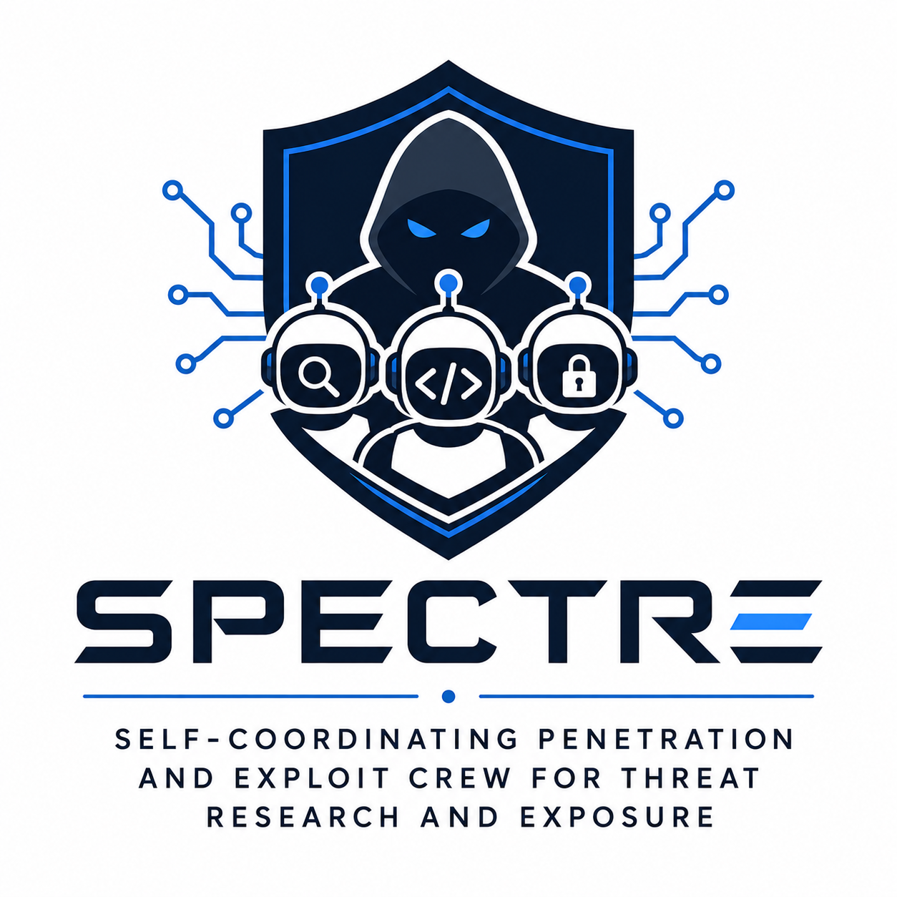
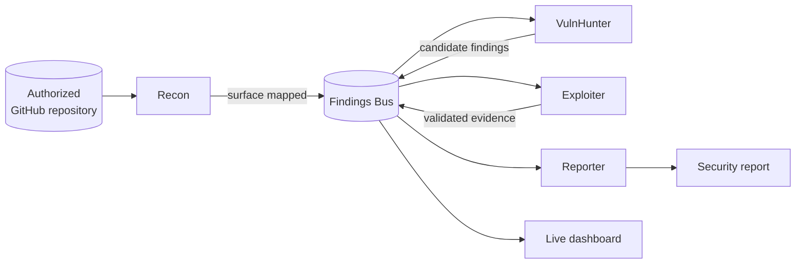

<p align="center">
  
</p>

<h1 align="center">SPECTRE</h1>

<p align="center">
  <strong>Self-coordinating Penetration and Exploit Crew for Threat Research and Exposure</strong>
</p>

<p align="center">
  A multi-agent platform for transparent, scope-controlled GitHub repository security audits.
</p>

<p align="center">
  
  
  
  
</p>

---

SPECTRE coordinates a crew of specialized AI agents to map repository attack
surfaces, identify security issues, validate evidence, and assemble a report.
Every finding and handoff is published through a shared event bus, making the
crew's work observable in a real-time web dashboard.

> [!IMPORTANT]
> SPECTRE is designed exclusively for repositories you own or have explicit
> permission to audit. Every engagement is restricted by a repository allowlist.

## What SPECTRE provides

- **Four-agent security crew** — Recon, VulnHunter, Exploiter, and Reporter
  contribute distinct capabilities to one coordinated engagement.
- **Visible coordination** — agent activity, findings, and handoff reasons stream
  to the dashboard over WebSocket.
- **Structured shared memory** — the Findings Bus provides an event-sourced
  record of discoveries and validation attempts.
- **Security tool integration** — sandboxed wrappers connect GitHub, gitleaks,
  and osv-scanner to the audit workflow.
- **Safety by default** — scope enforcement, secret redaction, API audit logs,
  timeouts, and a human-operated kill switch constrain every run.
- **Repeatable reporting** — confirmed evidence is synthesized into a clear,
  actionable repository security report.

## How it works



Agents never call one another directly. They publish structured events to the
Findings Bus, while the orchestrator evaluates those events and records each
handoff with a human-readable reason.

## Quick start

### Docker Compose (recommended)

Requirements: Docker with Compose and credentials for GitHub and your selected
LLM provider.

```bash
cp .env.example .env
```

Add `GITHUB_TOKEN` and the API key for your configured provider to `.env`, then
start the application:

```bash
docker compose up --build
```

Open [http://localhost:8080](http://localhost:8080) and select **Start audit**.
The default engagement targets only the allowlisted repository in
`scopes/spectre.yaml`.

For configuration details, see the
[Docker guide](docs/local/local-dev-docker.md).

### Local development

Requirements: Python 3.12+, Node.js, npm, and any external scanners used by the
engagement.

```bash
# Install the Python application and development tools
python3 -m venv .venv
source .venv/bin/activate
pip install -e ".[dev]"

# Install the dashboard
npm install

# Configure credentials and runtime settings
cp .env.example .env
```

After adding your credentials to `.env`, start the backend and dashboard in
separate terminals:

```bash
# Terminal 1 — control server and WebSocket stream
source .venv/bin/activate
python -m spectre.cli serve
```

```bash
# Terminal 2 — Vite dashboard
npm run dev
```

Open [http://localhost:5173](http://localhost:5173).

## Repository structure

```text
spectre/
  agents/          Specialized audit agents and reasoning
  bus/             Findings store and event publication
  orchestrator/    Engagement lifecycle and handoffs
  safety/          Scope enforcement, audit logs, and halt controls
  schemas/         Shared Pydantic models
  tools/           Sandboxed GitHub and scanner integrations
src/               React + TypeScript dashboard
scopes/            Per-engagement repository allowlists
tests/             Python test suite
docs/local/        Architecture and development documentation
```

## Quality checks

```bash
pytest
npm test
npm run build
```

## Documentation

- [Agent and contributor guide](AGENTS.md)
- [Documentation index](docs/local/README.md)
- [Architecture overview](docs/local/local-arch-overview.md)
- [Findings Bus](docs/local/local-arch-findings-bus.md)
- [Handoff protocol](docs/local/local-arch-handoff-protocol.md)
- [Safety and repository scope](docs/local/local-safety-lab-scope.md)
- [Project roadmap](docs/local/local-plan-roadmap.md)

## Security and responsible use

SPECTRE is a defensive research and auditing tool. Do not use it to scan
repositories without authorization. Keep credentials in `.env`, never commit
tokens or captured secrets, and review scope files before every engagement.

If you discover a security issue in SPECTRE itself, report it privately to the
maintainers rather than opening a public issue with exploit details.
