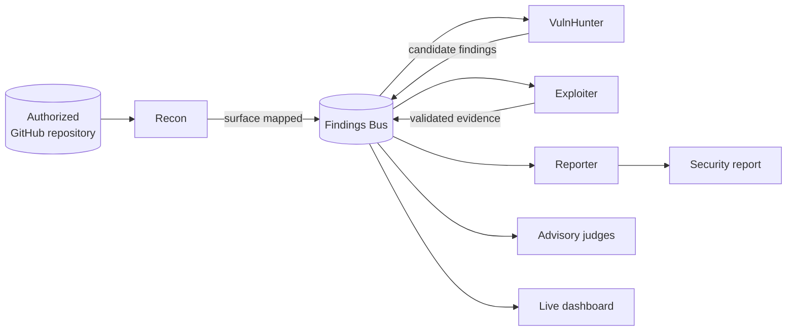

<p align="center">
  
</p>

<h1 align="center">SPECTRE</h1>

<p align="center">
  <strong>Self-coordinating Penetration and Exploit Crew for Threat Research and Exposure</strong>
</p>

<p align="center">
  A multi-agent platform for transparent, scope-controlled GitHub repository security audits.
</p>

<p align="center">
  
  
  
  
</p>

---

SPECTRE coordinates a crew of specialized AI agents to map repository attack
surfaces, identify security issues, validate evidence, and assemble a report.
Every finding and handoff is published through a shared event bus, making the
crew's work observable in a real-time web dashboard.

> [!IMPORTANT]
> SPECTRE is designed exclusively for repositories you own or have explicit
> permission to audit. Every engagement is restricted by a repository allowlist.

## What SPECTRE provides

- **Four-agent security crew** — Recon, VulnHunter, Exploiter, and Reporter
- **Advisory judges** — Finding / Handoff / Report judges publish verdicts without changing deterministic handoffs
- **Visible coordination** — agent chat, findings, handoffs, and report sections stream over WebSocket
- **Findings Bus** — event-sourced shared memory for discoveries and validation attempts
- **Tool wrappers** — sandboxed GitHub API, gitleaks (with fallback), osv-scanner, workflow analyzer
- **Research exports** — `spectre metrics` (coordination JSON) and `spectre replay` (paced session playback)
- **Handoff profiles** — swap threshold configs (`default` / `strict`) for A/B experiments
- **Safety by default** — scope allowlists, secret redaction, audit logs, timeouts, kill switch

## How it works



Agents never call one another directly. They publish structured events to the
Findings Bus; the orchestrator records each handoff with a human-readable reason.
Judges emit advisory verdicts only.

## Quick start

### Docker Compose (recommended)

Requirements: Docker with Compose, plus `GITHUB_TOKEN` and an LLM API key (Groq by default).

```bash
cp .env.example .env
# Edit .env — set GITHUB_TOKEN and GROQ_API_KEY (or another LLM provider)
docker compose up --build
```

Open [http://localhost:8080](http://localhost:8080) and select **Start audit**.
The compose stack runs nginx (UI) plus `spectre serve` (WebSocket control server).
Default scope: `scopes/spectre.yaml` (`tmestery/SPECTRE`).

See the [Docker guide](docs/local/local-dev-docker.md).

### Local development

Requirements: Python 3.12+, Node.js, npm. Optional: `gitleaks`, `osv-scanner`.

```bash
python3 -m venv .venv
source .venv/bin/activate
pip install -e ".[dev]"
npm install
cp .env.example .env
```

```bash
# Terminal 1 — control server + WebSocket
source .venv/bin/activate
python -m spectre.cli serve

# Terminal 2 — Vite dashboard
npm run dev
```

Open [http://localhost:5173](http://localhost:5173).

### CLI engagements

```bash
# One-shot audit (optional --ws, --handoff-profile strict)
python -m spectre.cli run \
  --repo tmestery/spectre-vuln-sample \
  --scope scopes/vuln-sample.yaml \
  --branch main

python -m spectre.cli report --session eng_<id>
python -m spectre.cli metrics --session eng_<id>
python -m spectre.cli replay --session eng_<id> --speed 2 --ws
python -m spectre.cli halt --session eng_<id>
```

Demo sample (fake secrets only): [`tmestery/spectre-vuln-sample`](https://github.com/tmestery/spectre-vuln-sample)
with `scopes/vuln-sample.yaml`.

## Repository structure

```text
spectre/           Python orchestration (agents, bus, tools, safety)
src/               React + TypeScript demo dashboard
scopes/            Per-engagement repository allowlists
tests/             Python tests (+ UI fixtures)
docs/local/        Architecture and development documentation
docs/assets/       Branding assets (logo)
```

## Quality checks

```bash
pytest
npm test
npm run build
```

CI runs on pull requests (pytest, Vitest, production build, gradual mypy).

## Documentation

- [Agent and contributor guide](AGENTS.md)
- [Documentation index](docs/local/README.md)
- [Architecture overview](docs/local/local-arch-overview.md)
- [Findings Bus](docs/local/local-arch-findings-bus.md)
- [Handoff protocol](docs/local/local-arch-handoff-protocol.md)
- [Judging agents](docs/local/local-arch-judging-agents.md)
- [Demo UI](docs/local/local-ui-demo-dashboard.md)
- [Safety and repository scope](docs/local/local-safety-lab-scope.md)
- [Project roadmap](docs/local/local-plan-roadmap.md)

## Security and responsible use

SPECTRE is a defensive research and auditing tool. Do not use it to scan
repositories without authorization. Keep credentials in `.env`, never commit
tokens or captured secrets, and review scope files before every engagement.

If you discover a security issue in SPECTRE itself, report it privately to the
maintainers rather than opening a public issue with exploit details.
