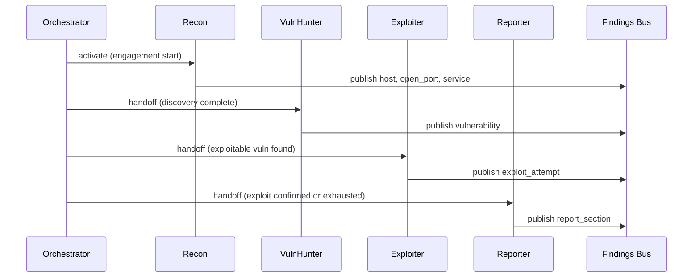

# local-arch-agent-crew

**Status:** active  
**Updated:** 2026-06-25  
**Related:** [local-arch-handoff-protocol.md](local-arch-handoff-protocol.md), [local-agent-recon.md](local-agent-recon.md)

## Summary

SPECTRE's agent crew consists of four specialized roles — Recon, VulnHunter, Exploiter, and Reporter — each with distinct tools, prompts, and handoff responsibilities. Agents never communicate directly; all coordination flows through the Findings Bus and Orchestrator.

## Context

The crew model mirrors human pen test teams: reconnaissance informs vulnerability analysis, which informs exploitation, which informs reporting. The research question is whether LLM agents can replicate this pipeline with explicit, loggable handoff rules.

## Implementation

### Crew overview



### Agent specifications

| Agent | ID | Activation trigger | Max iterations | Tool access |
|-------|-----|-------------------|----------------|-------------|
| Recon | `recon` | Engagement start | 3 | nmap, httpx, whatweb, dir enum |
| VulnHunter | `vuln_hunter` | `open_port` or `service` findings for in-scope host | 5 | nuclei, nikto, custom probes |
| Exploiter | `exploiter` | `vulnerability` with exploitability ≥ 0.7 | 3 | sqlmap, curl, PoC scripts |
| Reporter | `reporter` | Exploit success OR agent queue empty with vulns | 1 | read-only bus, report templates |

### Agent module structure

Each agent lives in `spectre/agents/<name>/`:

```
spectre/agents/recon/
  __init__.py
  agent.py        # Agent class, run loop
  prompt.md       # System prompt template
  tools.yaml      # Allowed tool list
  handoff.yaml    # What this agent publishes; what triggers next
```

### Prompt design principles

1. **Role-bound** — agent only performs its phase; no cross-phase tool use.
2. **Evidence-first** — every claim must cite tool output or bus finding ID.
3. **Structured output** — agents emit Finding objects, not freeform-only text.
4. **Summary for UI** — short human-readable message accompanies each finding for demo chat panel.
5. **Scope-aware** — prompt includes current allowlist; refuse out-of-scope suggestions.

### Agent lifecycle

```python
# Conceptual — implement in spectre/agents/base.py
class Agent:
    id: str
    tools: list[Tool]

    async def run(self, ctx: AgentContext) -> AgentResult:
        # 1. Read relevant bus findings since last activation
        # 2. LLM plans next tool calls (structured)
        # 3. Execute tools via sandboxed wrappers
        # 4. Parse output → Finding objects
        # 5. Publish findings to bus
        # 6. Return status: complete | needs_handoff | blocked
```

### Individual agent docs

| Agent | Doc |
|-------|-----|
| Recon | [local-agent-recon.md](local-agent-recon.md) |
| VulnHunter | [local-agent-vuln-hunter.md](local-agent-vuln-hunter.md) |
| Exploiter | [local-agent-exploiter.md](local-agent-exploiter.md) |
| Reporter | [local-agent-reporter.md](local-agent-reporter.md) |

## Tests

Per agent (Phase 1–2):

| Case | Type |
|------|------|
| Agent publishes valid finding from mock tool output | Positive |
| Agent rejects out-of-scope target | Negative |
| Agent handles empty tool output gracefully | Negative |
| Agent respects max iteration limit | Negative |
| Agent refuses wrong-phase tool (e.g. Recon calling sqlmap) | Negative |

## Changelog

- 2026-06-25 — Initial crew design
