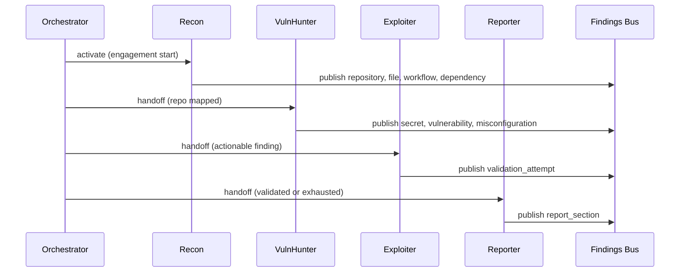

# local-arch-agent-crew

**Status:** active  
**Updated:** 2026-06-25  
**Related:** [local-arch-handoff-protocol.md](local-arch-handoff-protocol.md), [local-target-github-repo.md](local-target-github-repo.md)

## Summary

SPECTRE's agent crew audits authorized GitHub repos through four roles — Recon, VulnHunter, Exploiter, and Reporter. Agents never communicate directly; all coordination flows through the Findings Bus and Orchestrator.

## Context

The crew mirrors security review workflows: map the repo → hunt issues → validate impact → report. The research question is whether LLM agents can replicate this with explicit, loggable handoff rules.

## Implementation

### Crew overview

### Agent specifications

| Agent | Status | Handoff trigger | Max iterations | Tool access |
|-------|--------|-----------------|----------------|-------------|
| Recon | `recon` | Engagement start | 3 | GitHub API, clone, tree walk |
| VulnHunter | `vuln_hunter` | Repo surface mapped | 5 | gitleaks, osv-scanner, workflow parser |
| Exploiter | `exploiter` | Actionable finding | 3 | format validators, reachability analyzer |
| Reporter | `reporter` | Validation done or exhausted | 1 | read-only bus, report templates |

### Individual agent docs

| Agent | Doc |
|-------|-----|
| Recon | [local-agent-recon.md](local-agent-recon.md) |
| VulnHunter | [local-agent-vuln-hunter.md](local-agent-vuln-hunter.md) |
| Exploiter | [local-agent-exploiter.md](local-agent-exploiter.md) |
| Reporter | [local-agent-reporter.md](local-agent-reporter.md) |

## Changelog

- 2026-06-25 — Updated crew for GitHub repo auditing
- 2026-06-25 — Initial crew design
