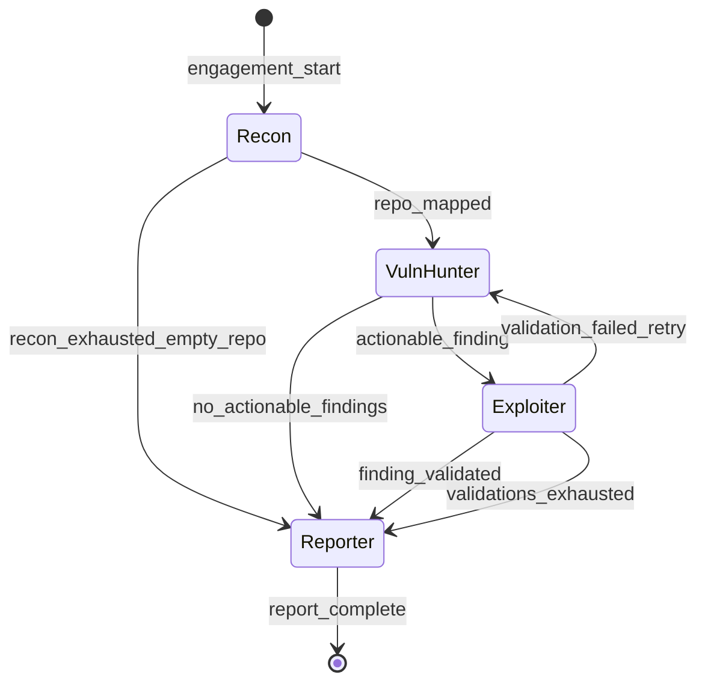

# local-arch-handoff-protocol

**Status:** active  
**Updated:** 2026-06-25  
**Related:** [local-arch-agent-crew.md](local-arch-agent-crew.md), [local-target-github-repo.md](local-target-github-repo.md)

## Summary

The handoff protocol defines **when** the orchestrator activates the next agent and **why** during a GitHub repo audit. Every decision is logged as a `handoff_decision` event — the primary research artifact for studying agent coordination.

## Context

Security auditors implicitly hand off: "I've mapped the repo, now someone should hunt secrets in history." SPECTRE makes this explicit with deterministic rules (v1).

## Implementation

### Handoff state machine



### Rules (v1 — deterministic)

#### R1: Recon → VulnHunter

```yaml
name: repo_mapped
from: recon
to: vuln_hunter
when:
  all:
    - finding.type == repository
    - finding.target in scope.allowed_repos
    - count(findings where type in [file, workflow, dependency]) >= 1
rationale: "Recon mapped repo structure with at least one scannable surface."
```

#### R2: VulnHunter → Exploiter

```yaml
name: actionable_finding
from: vuln_hunter
to: exploiter
when:
  any:
    - finding.type == secret AND finding.confidence >= 0.8
    - finding.type == vulnerability AND finding.evidence.exploitability >= 0.7
    - finding.type == misconfiguration AND finding.severity in [high, critical]
rationale: "VulnHunter found a secret, CVE, or high-severity misconfig worth validating."
```

#### R3: Exploiter → Reporter

```yaml
name: finding_validated
from: exploiter
to: reporter
when:
  any:
    - finding.type == validation_attempt AND finding.status == confirmed
    - agent.iterations_exhausted AND count(findings where severity >= medium) > 0
rationale: "Finding validated or all validation attempts exhausted with reportable issues."
```

#### R4: Engagement timeout

```yaml
name: engagement_timeout
from: "*"
to: reporter
when:
  engagement.elapsed > engagement.max_duration
rationale: "Time limit reached; generating partial report."
```

### Handoff decision event (example)

```json
{
  "type": "handoff_decision",
  "rule": "actionable_finding",
  "from_agent": "vuln_hunter",
  "to_agent": "exploiter",
  "input_finding_ids": ["fnd_abc"],
  "rationale": "VulnHunter found AWS key in src/config.ts (commit a1b2c3d) with confidence 0.92.",
  "timestamp": "2026-06-25T12:05:00Z"
}
```

## Tests

| Case | Type |
|------|------|
| R1 fires when repo + file findings exist | Positive |
| R1 does not fire for out-of-scope repo slug | Negative |
| R2 does not fire when secret confidence < 0.8 | Negative |
| R4 fires on timeout | Negative |
| Handoff event has required fields | Negative |

## Changelog

- 2026-06-25 — Rewrote rules for GitHub repo auditing
- 2026-06-25 — Initial handoff protocol
