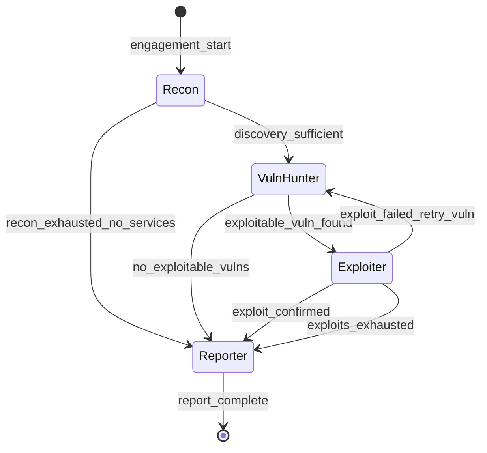

# local-arch-handoff-protocol

**Status:** active  
**Updated:** 2026-06-25  
**Related:** [local-arch-agent-crew.md](local-arch-agent-crew.md), [local-arch-orchestrator.md](local-arch-orchestrator.md)

## Summary

The handoff protocol defines **when** the orchestrator activates the next agent and **why**. Every decision is logged as a `handoff_decision` event with inputs, rule name, and human-readable rationale — the primary research artifact for studying agent coordination.

## Context

Human pen testers implicitly hand off: "I found a web server, now someone should look for vulns." SPECTRE makes this explicit with deterministic rules (v1) that can later be extended with LLM-assisted prioritization (v2).

## Implementation

### Handoff state machine



### Rules (v1 — deterministic)

#### R1: Recon → VulnHunter

```yaml
name: discovery_sufficient
from: recon
to: vuln_hunter
when:
  all:
    - finding.type in [open_port, service]
    - finding.target in scope.allowlist
    - count(findings where type=service) >= 1
rationale: "Recon identified at least one service on an in-scope host."
```

#### R2: VulnHunter → Exploiter

```yaml
name: exploitable_vuln_found
from: vuln_hunter
to: exploiter
when:
  all:
    - finding.type == vulnerability
    - finding.status in [tentative, confirmed]
    - finding.evidence.exploitability >= 0.7
rationale: "VulnHunter found a vulnerability with exploitability >= 0.7."
```

#### R3: Exploiter → Reporter

```yaml
name: exploit_confirmed
from: exploiter
to: reporter
when:
  any:
    - finding.type == exploit_attempt AND finding.status == exploited
    - agent.iterations_exhausted AND count(vulnerability) > 0
rationale: "Exploitation confirmed or all exploit attempts exhausted with findings to report."
```

#### R4: Any → Reporter (early exit)

```yaml
name: engagement_timeout
from: "*"
to: reporter
when:
  engagement.elapsed > engagement.max_duration
rationale: "Engagement time limit reached; generating partial report."
```

### Handoff decision event

```json
{
  "type": "handoff_decision",
  "rule": "exploitable_vuln_found",
  "from_agent": "vuln_hunter",
  "to_agent": "exploiter",
  "input_finding_ids": ["fnd_abc", "fnd_def"],
  "rationale": "VulnHunter found SQL injection on /vulnerabilities/sqli/ with exploitability 0.85.",
  "timestamp": "2026-06-25T12:05:00Z"
}
```

### Agent completion signals

Agents return one of:

| Status | Meaning | Orchestrator action |
|--------|---------|---------------------|
| `complete` | Phase done, findings published | Evaluate handoff rules |
| `blocked` | Scope violation or tool failure | Log, retry or halt |
| `exhausted` | Max iterations, no more actions | Evaluate fallback rules |

### Research instrumentation (Phase 4)

Export per session:

- `handoffs.jsonl` — all handoff decisions
- `timeline.json` — agent active intervals
- `metrics.json` — time-to-first-vuln, handoff count, findings per agent

### Future: LLM-assisted prioritization (v2)

When multiple vulns exist, an optional **Prioritizer** step (not a full agent) ranks findings before Exploiter activation. Logged separately to compare deterministic vs LLM-ranked handoffs.

## Tests

| Case | Type |
|------|------|
| R1 fires when service finding exists on scope host | Positive |
| R1 does not fire when only out-of-scope findings | Negative |
| R2 does not fire when exploitability < 0.7 | Negative |
| R4 fires on timeout with partial findings | Negative |
| Handoff decision event contains all required fields | Negative |

## Changelog

- 2026-06-25 — Initial handoff protocol
