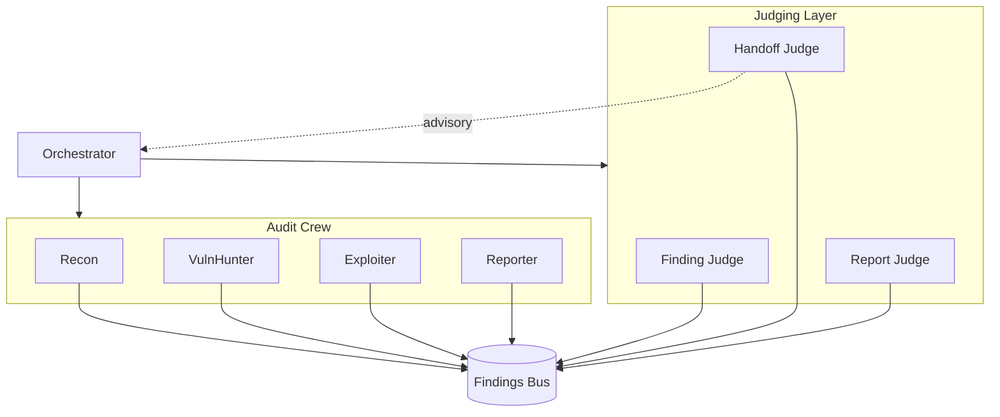
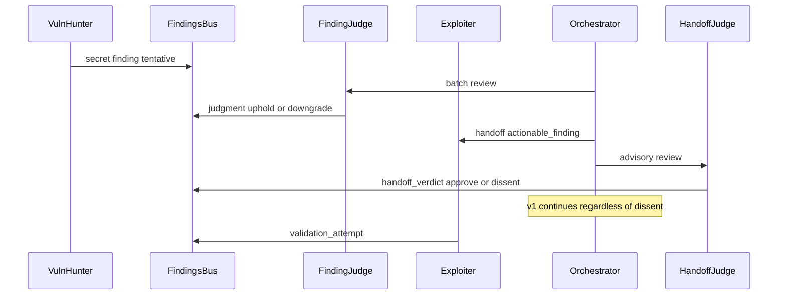

# local-arch-judging-agents

**Status:** active (design)  
**Updated:** 2026-06-25  
**Related:** [local-arch-agent-crew.md](local-arch-agent-crew.md), [local-arch-handoff-protocol.md](local-arch-handoff-protocol.md), [local-arch-llm-layer.md](local-arch-llm-layer.md), [local-research-metrics.md](local-research-metrics.md), issue #22

## Summary

Judging agents are a peer-review layer that evaluates findings, handoff decisions, and report quality. They publish structured verdicts to the Findings Bus. v1 is **advisory only** (log dissent; never block the crew). Implementation is tracked in child issues — this document is the ADR.

## Context

The audit crew already runs tools + LLM reasoning with deterministic handoff thresholds. Missing pieces:

- No structured resolution when VulnHunter and Exploiter disagree
- Handoffs fire on numeric gates without contextual review
- Reporter output is not independently checked for hallucination
- Research lacks a first-class **verdict / dissent** artifact

Judges fill that gap without breaking bus-first coordination.

## Decisions (resolved)

| Question | Decision |
|----------|----------|
| Per-finding vs batch? | **Batch** after each crew agent phase (Finding Judge after VulnHunter and after Exploiter) |
| Blocking mode? | **Advisory default** for v1; blocking is v2 (optional later for `critical` only) |
| Max judge cost? | Cap at **3 LLM steps per judge activation**; skip gracefully if LLM disabled |
| One vs three roles? | **Three specialized judges** — Finding, Handoff, Report |
| UI surface? | Verdict badges on findings/handoffs + judge `agent_message` lines in chat; export in metrics/session artifacts |

## Architecture

### Design principles

1. **Bus-first** — judges publish findings/events; never call crew agents directly
2. **Orchestrator-owned activation** — same registry/scheduling model as crew agents
3. **Advisory v1** — dissent is logged; handoffs still follow deterministic rules
4. **Read-only tools** — judges may read the bus and redacted evidence only (no clone/scan)
5. **Deterministic fallback** — without LLM: emit rule-based verdicts or `skipped` status

### Judge roles

| Judge | Agent id | Activates after | Evaluates | Publishes |
|-------|----------|-----------------|-----------|-----------|
| Finding Judge | `finding_judge` | VulnHunter complete; Exploiter complete | Confidence, severity, evidence sufficiency | `judgment` findings |
| Handoff Judge | `handoff_judge` | Each `handoff_decision` (async advisory) | Whether transition is justified | `handoff_verdict` event |
| Report Judge | `report_judge` | Reporter draft sections | Accuracy, completeness, no invented paths/CVEs | `report_verdict` event + notes |

### Disagreement sequence

## Schemas (implemented)

Module: `spectre/schemas/judging.py`

### Finding type

- `FindingType.JUDGMENT` — links to reviewed finding via `related_ids`; evidence includes `verdict` (`uphold` \| `downgrade` \| `dismiss`), `rationale`, `reviewed_finding_id`
- Helper: `make_judgment_finding(...)`

### Event types

- `EventType.HANDOFF_VERDICT` — `{ decision_id, verdict: approve|defer|reject, rationale, advisory: true }`
- `EventType.REPORT_VERDICT` — `{ report_section_ids, verdict: accept|revise, issues: [...], rationale, advisory: true }`
- Helpers: `handoff_verdict_event`, `report_verdict_event`
- v1: `advisory` must be `true` (validated by Pydantic)
- Relayed on the WebSocket stream; UI types accept the events (visual badges in #34)

## Safety

- Scope allowlist in every judge prompt
- Secrets only as already-redacted snippets from the bus
- Judges must not invent file paths, CVEs, or out-of-scope repos
- Audit every judge LLM call as `llm_invocation` with `metadata.phase=judge`

## Implementation children

| # | Issue |
|---|-------|
| [#29](https://github.com/tmestery/SPECTRE/issues/29) | Judging schemas: `judgment` + verdict events |
| [#30](https://github.com/tmestery/SPECTRE/issues/30) | Finding Judge agent |
| [#31](https://github.com/tmestery/SPECTRE/issues/31) | Handoff Judge agent |
| [#32](https://github.com/tmestery/SPECTRE/issues/32) | Report Judge agent |
| [#33](https://github.com/tmestery/SPECTRE/issues/33) | Orchestrator advisory judge scheduling |
| [#34](https://github.com/tmestery/SPECTRE/issues/34) | Demo UI: judge verdict badges + chat styling |

Related follow-ons: [#28](https://github.com/tmestery/SPECTRE/issues/28) demo UI redesign (land before #34).

## Non-goals (v1)

- Running scanners or cloning repos
- Modifying scope allowlists
- Org-wide / multi-repo judging
- Auto-PR remediation from verdicts
- Blocking handoffs (v2)

## Tests (when implemented)

| Case | Type |
|------|------|
| Finding Judge upholds high-confidence secret | Positive |
| Out-of-scope target rejected before judge run | Negative |
| Advisory dissent does not block handoff | Negative |
| LLM disabled → skip or rule-based verdict | Negative |

## Changelog

- 2026-06-25 — Schemas implemented in `spectre/schemas/judging.py` (#29)
- 2026-06-25 — ADR for judging agent layer; open questions resolved (#22)
