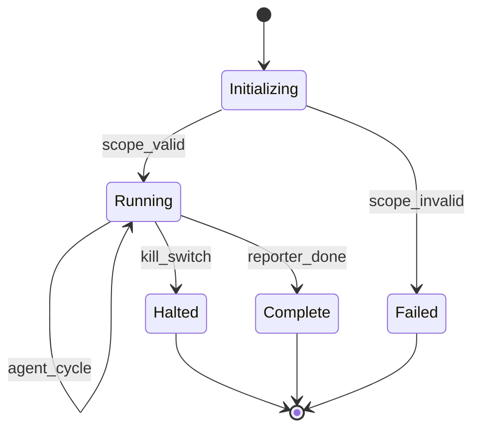

# local-arch-orchestrator

**Status:** active  
**Updated:** 2026-06-25  
**Related:** [local-arch-handoff-protocol.md](local-arch-handoff-protocol.md), [local-arch-findings-bus.md](local-arch-findings-bus.md)

## Summary

The orchestrator is SPECTRE's control plane — it manages engagement lifecycle, activates agents, evaluates handoff rules, enforces safety constraints, and streams events to the demo UI.

## Context

The orchestrator is **not** an agent. It does not perform recon or exploitation. It schedules agents, evaluates bus state, and logs decisions. This separation keeps coordination logic testable and independent of LLM behavior.

## Implementation

### Engagement lifecycle



### Main loop (conceptual)

```python
async def run_engagement(engagement: Engagement) -> EngagementResult:
    await bus.publish(engagement_started(engagement))
    await safety.validate_scope(engagement.scope)

    current_agent = "recon"
    while engagement.status == "running":
        if engagement.halt_requested:
            break

        ctx = build_context(current_agent, bus)
        result = await registry.run_agent(current_agent, ctx)

        if result.status == "blocked":
            await handle_blocked(result)
            continue

        decision = handoff_engine.evaluate(bus, current_agent, result)
        await bus.publish(decision)

        if decision.to_agent is None:
            break
        current_agent = decision.to_agent

    await bus.publish(engagement_complete(engagement))
```

### Components

| Module | Path | Responsibility |
|--------|------|----------------|
| Loop | `spectre/orchestrator/loop.py` | Main engagement loop |
| Handoffs | `spectre/orchestrator/handoffs.py` | Rule evaluation |
| Registry | `spectre/orchestrator/registry.py` | Agent lookup and dispatch |
| Context | `spectre/orchestrator/context.py` | Build AgentContext from bus |
| Server | `spectre/orchestrator/server.py` | WebSocket + REST for UI |

### AgentContext

Passed to each agent on activation:

```python
class AgentContext(BaseModel):
    engagement_id: str
    scope: Scope
    agent_id: str
    activation_id: str
    relevant_findings: list[Finding]   # pre-filtered for this agent
    prior_messages: list[AgentMessage]  # recent bus messages for continuity
    iteration: int
    max_iterations: int
```

### CLI interface

```bash
# Start engagement
python -m spectre.cli run --target dvwa --scope targets/dvwa/scope.yaml

# Halt running engagement
python -m spectre.cli halt --session <id>

# Export report
python -m spectre.cli report --session <id> --format markdown

# Replay from event log (paced; no agents/tools)
python -m spectre.cli replay --session <id>
python -m spectre.cli replay --session <id> --speed 1 --ws
```

See [local-research-replay.md](local-research-replay.md).

### WebSocket API (v1)

| Message | Direction | Purpose |
|---------|-----------|---------|
| `subscribe` | Client → Server | Join session stream |
| `event` | Server → Client | Bus event JSON |
| `halt` | Client → Server | Kill switch |

Default: `ws://localhost:8765/sessions/<id>`

### Error handling

| Error | Action |
|-------|--------|
| Scope violation | Halt engagement, audit log, notify UI |
| Tool timeout | Agent returns `blocked`, orchestrator retries once |
| LLM failure | Agent returns `blocked`, log error, skip to handoff eval |
| Max engagement duration | Trigger R4 → Reporter |

## Tests

| Case | Type |
|------|------|
| Full loop Recon → Reporter with mock agents | Positive |
| Invalid scope aborts before agent run | Negative |
| Kill switch halts within one loop iteration | Negative |
| Handoff engine called after each agent completion | Negative |
| WebSocket broadcasts published events | Negative |

## Changelog

- 2026-06-25 — Documented `spectre replay` paced playback (#15)
- 2026-06-25 — Initial orchestrator design
