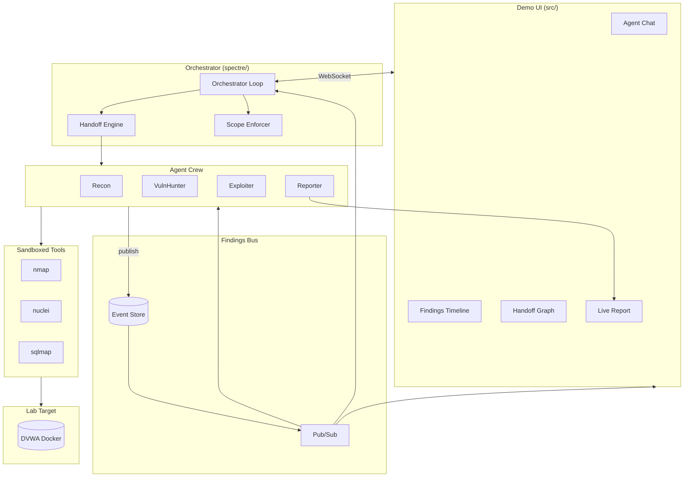

# local-arch-overview

**Status:** active  
**Updated:** 2026-06-25  
**Related:** [AGENTS.md](../../AGENTS.md), [local-plan-roadmap.md](local-plan-roadmap.md)

## Summary

SPECTRE is a multi-agent penetration testing system for **authorized lab targets**. A Python orchestrator runs a crew of four LLM-powered agents (Recon, VulnHunter, Exploiter, Reporter) that coordinate through a shared Findings Bus. A React demo UI streams agent activity in real time.

## Context

- **Research focus:** Agent coordination, finding sharing, and handoff decisions.
- **Demo:** Visual progression from recon to exploit on DVWA.
- **Safety:** Scope allowlists, audit logging, lab targets only.

## Implementation

### System diagram



### Folder layout

```
spectre/
  agents/
    recon/
    vuln_hunter/
    exploiter/
    reporter/
  orchestrator/
    loop.py
    handoffs.py
    registry.py
  bus/
    store.py
    events.py
    pubsub.py
  tools/
    nmap.py
    nuclei.py
    sqlmap.py
    base.py          # scope check, timeout, audit
  schemas/
    finding.py
    handoff.py
    engagement.py
    report.py
  safety/
    scope.py
    audit.py
  cli.py
src/
  app/
  crew/
  findings/
  target/
  report/
targets/
  dvwa/
    docker-compose.yml
    scope.yaml
docs/local/
tests/
```

### Core flows

1. **Engagement start** — CLI loads `scope.yaml`, starts orchestrator, initializes empty bus.
2. **Recon activation** — Orchestrator wakes Recon; Recon runs tools, publishes findings.
3. **Handoff** — Handoff engine evaluates bus state, activates next agent with logged reason.
4. **Exploitation** — Exploiter confirms vulns; publishes `exploit_attempt` findings.
5. **Report** — Reporter synthesizes bus state into report artifacts.
6. **Streaming** — All bus events broadcast to demo UI via WebSocket.

### Related docs

| Topic | Doc |
|-------|-----|
| Agent roles | [local-arch-agent-crew.md](local-arch-agent-crew.md) |
| Shared memory | [local-arch-findings-bus.md](local-arch-findings-bus.md) |
| Handoffs | [local-arch-handoff-protocol.md](local-arch-handoff-protocol.md) |
| Orchestrator | [local-arch-orchestrator.md](local-arch-orchestrator.md) |
| Tech choices | [local-arch-tech-stack.md](local-arch-tech-stack.md) |
| Safety | [local-safety-lab-scope.md](local-safety-lab-scope.md) |

## Tests

Test infrastructure planned in Phase 1. Each feature requires 1 positive + 3 negative tests per [local-dev-standards.md](local-dev-standards.md). See [local-test-strategy.md](local-test-strategy.md).

## Changelog

- 2026-06-25 — Initial architecture doc
