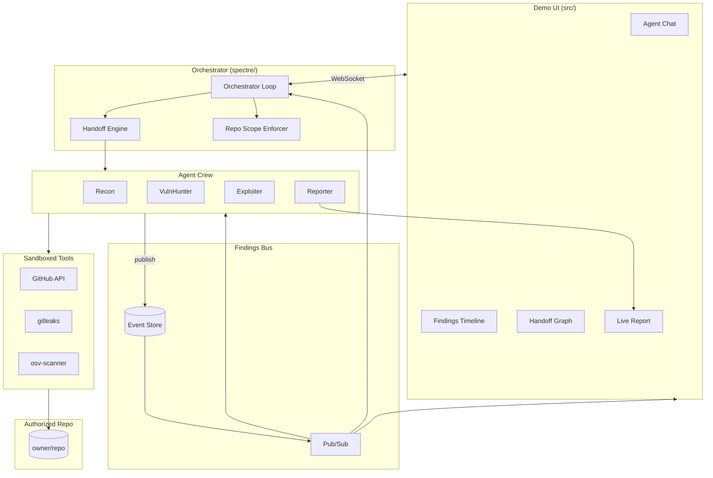

# local-arch-overview

**Status:** active  
**Updated:** 2026-06-25  
**Related:** [AGENTS.md](../../AGENTS.md), [local-plan-roadmap.md](local-plan-roadmap.md)

## Summary

SPECTRE is a multi-agent **GitHub repository security auditing** system. A Python orchestrator runs a crew of four LLM-powered agents (Recon, VulnHunter, Exploiter, Reporter) that coordinate through a shared Findings Bus. A React demo UI streams agent activity in real time as they audit an authorized repo.

## Context

- **Research focus:** Agent coordination, finding sharing, and handoff decisions.
- **Demo:** Visual progression from repo mapping → secret/CVE discovery → validation → report.
- **Safety:** Repo allowlists, token redaction, audit logging, authorized targets only.

## Implementation

### System diagram



### Folder layout

```
spectre/
  agents/
    recon/
    vuln_hunter/
    exploiter/
    reporter/
  orchestrator/
  bus/
  tools/
    github.py
    gitleaks.py
    osv_scanner.py
    base.py
  schemas/
  safety/
  cli.py
src/
  app/
  crew/
  findings/
  target/
  report/
scopes/               # allowed_repos per engagement
docs/local/
tests/
```

### Core flows

1. **Engagement start** — CLI loads `scopes/<name>.yaml`, validates `GITHUB_TOKEN`, initializes bus.
2. **Recon activation** — Maps repo via GitHub API + clone; publishes structure findings.
3. **Handoff** — Handoff engine activates VulnHunter when surface mapped.
4. **VulnHunter** — Runs gitleaks, osv-scanner; publishes secrets and CVEs.
5. **Exploiter** — Validates findings; publishes `validation_attempt`.
6. **Report** — Reporter synthesizes bus state into report with file permalinks.
7. **Streaming** — All bus events broadcast to demo UI via WebSocket.

### Related docs

| Topic | Doc |
|-------|-----|
| Agent roles | [local-arch-agent-crew.md](local-arch-agent-crew.md) |
| Shared memory | [local-arch-findings-bus.md](local-arch-findings-bus.md) |
| Handoffs | [local-arch-handoff-protocol.md](local-arch-handoff-protocol.md) |
| GitHub target | [local-target-github-repo.md](local-target-github-repo.md) |
| Safety | [local-safety-lab-scope.md](local-safety-lab-scope.md) |

## Tests

Test infrastructure planned in Phase 1. See [local-test-strategy.md](local-test-strategy.md).

## Changelog

- 2026-06-25 — Pivot to GitHub repo auditing as primary target
- 2026-06-25 — Initial architecture doc
