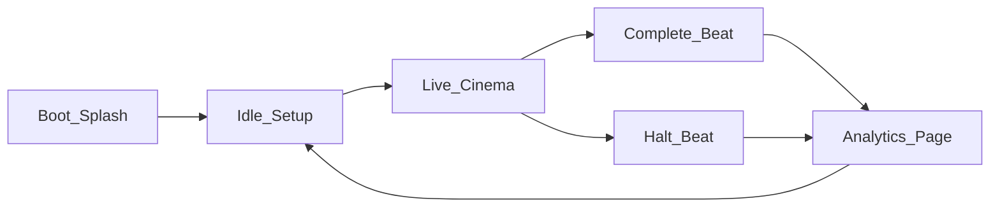

# local-ui-demo-dashboard

**Status:** active  
**Updated:** 2026-10-11  
**Related:** [local-arch-orchestrator.md](local-arch-orchestrator.md), [local-arch-judging-agents.md](local-arch-judging-agents.md), issue #57

## Summary

The demo UI is a **phased cinematic experience**: branded boot splash → setup → focused live audit stage with progress rail → auto-transition into a scrollable analytics/results page. The old always-on 2×2 analytics grid is the *finale*, not the live view.

## Context

Viewers should watch the crew work with calm immersion (one primary focus), then review full findings, handoffs, and report after the engagement ends.

## Experience model



| Phase | Focus |
|-------|--------|
| **Boot** | Full-viewport SPECTRE mark until WebSocket `server_hello` + min dwell (~1s) |
| **Setup** | Repo / branch / scope + Start; past sessions load jump to analytics |
| **Live cinema** | Progress rail + active agent stage + latest discovery + Halt |
| **Complete beat** | Brief “Audit complete” / “Halted”, then auto-advance |
| **Analytics** | Scrollable summary → findings → handoffs → report → optional crew log |

## Live cinema rules

- Crew stages only: Recon → VulnHunter → Exploiter → Reporter
- Judges do not steal the progress rail; muted in full crew log on analytics
- Cap live feed to ~4 newest crew messages
- One latest discovery card + count badge
- Soft motion; `prefers-reduced-motion` respected

## Source layout

```
src/
  app/App.tsx, BootSplash.tsx, CompleteBeat.tsx, SetupView.tsx, app.css
  crew/LiveCinemaView.tsx, ProgressRail.tsx, LiveStage.tsx, LatestDiscovery.tsx
  report/AnalyticsPage.tsx, LiveReportPanel.tsx
  findings/…, hooks/useEngagementStream.ts, lib/crewStages.ts
```

## WebSocket routing

| Event | Effect |
|-------|--------|
| `agent_activated` | Sets `activeAgent` (crew only) for progress rail |
| `agent_message` | Live feed + crew `activeAgent` fallback |
| `finding` | Latest discovery / analytics timeline; judgments matched by id |
| `handoff_decision` / `handoff_verdict` | Analytics handoffs |
| `report_section` / `report_verdict` | Analytics report |
| `engagement_complete` / `halted` | Complete beat → analytics |

## Tests

| Case | Type |
|------|------|
| Boot splash connecting / retry | Positive |
| `agent_activated` sets crew activeAgent | Positive |
| Judge activation ignored for stage | Negative |
| Progress rail unknown agent safe | Negative |
| resolveActiveCrewAgent fallbacks | Positive + negatives |
| Message feed capped / judges skipped | Negative |
| Complete beat copy | Positive |

## Changelog

- 2026-10-11 — Boot → live cinema → analytics finale (#57)
- 2026-10-10 — Visual redesign + judge verdict badges (#28, #34)
- 2026-06-25 — Initial demo UI doc
